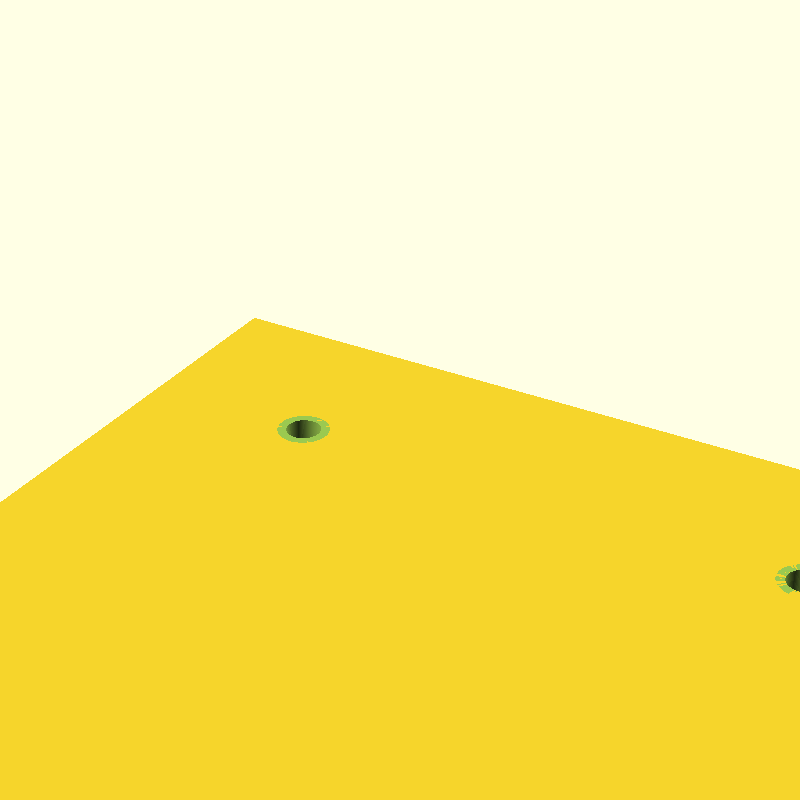

# FreeCAD + MCP: пайплайн 3D-проектирования

Практический гайд по пайплайну, который мы собрали для проектирования деталей
под 3D-печать, CNC и лазер.

 Модель строится кодом в FreeCAD, а качество
проверяется измерениями и скриншотами — не «на глаз».

Стек:

- **FreeCAD 1.1.x** (GUI) + аддон **Robust MCP Bridge**;
- **freecad-mcp** — MCP-сервер, через который агент или Codex управляют FreeCAD;
- **OpenClaw / Codex CLI** — постановка задачи, генерация и правки геометрии;
- производство: **Qidi Q1 Pro** (FDM), **CNC 3018** (200 W), **лазер 5 W**.

## Идея в одном абзаце

Агент не рисует мышкой и не «прикидывает» форму. Он пишет параметрический
Python-скрипт, выполняет его в живом FreeCAD через MCP, получает скриншот и
числа (объём, габариты, количество тел), сверяет их с аналитическим расчётом,
прогоняет проверку B-rep и DFM/DfAM-лимиты под конкретный станок. Только после
этого экспортируются `.step` / `.stl` / `.dxf`.

```
ТЗ и размеры
    │
    ▼
параметрический скрипт (FreeCAD Part API)
    │  MCP execute_code: 1 вызов = 1–3 булевы операции
    ▼
скриншот + числовая сверка (bbox / volume / features)
    │
    ▼
CheckGeometry: isValid, 1 solid, без дыр
    │
    ├── DfAM (Q1 Pro): стенки, нависания, поддержки, ориентация
    └── DFM (CNC 3018 / лазер): радиусы, глубины, доступ, kerf
    │
    ▼
.fcstd (исходник) + .step / .stl / .dxf (производные)
```

## Быстрый старт

1. Поставьте FreeCAD 1.1.x и аддон **Robust MCP Bridge**, запустите мост —
   подробно в [docs/01-setup.md](docs/01-setup.md).
2. Подключите `freecad-mcp` к своему агенту (OpenClaw) или Codex CLI.
3. Проверьте связь: `get_connection_status` должен вернуть `connected`.
4. Дайте агенту ТЗ по шаблону из [docs/02-modeling.md](docs/02-modeling.md).
5. Прогоните проверки из [docs/03-verification.md](docs/03-verification.md)
   и чек-лист [docs/09-checklist.md](docs/09-checklist.md).

## Что внутри

| Раздел | О чём |
|---|---|
| [docs/01-setup.md](docs/01-setup.md) | Установка FreeCAD, моста и MCP-сервера, конфиги OpenClaw и Codex |
| [docs/02-modeling.md](docs/02-modeling.md) | Правила моделирования, шаблон параметрической детали, идиомы FreeCAD |
| [docs/03-verification.md](docs/03-verification.md) | Скриншот, числовая сверка, CheckGeometry, отчёт |
| [docs/04-dfam-print.md](docs/04-dfam-print.md) | Печатаемость на Q1 Pro: стенки, нависания, ориентация |
| [docs/05-dfm-cnc-laser.md](docs/05-dfm-cnc-laser.md) | Фрезеровка на CNC 3018 и резка лазером 5 W |
| [docs/06-purchased-parts.md](docs/06-purchased-parts.md) | Готовые STEP-детали из step.parts |
| [docs/07-codex-delegation.md](docs/07-codex-delegation.md) | Делегирование генерации кода в Codex CLI |
| [docs/08-troubleshooting.md](docs/08-troubleshooting.md) | Мост не отвечает, OOM, лимиты MCP, типовые ошибки |
| [docs/09-checklist.md](docs/09-checklist.md) | Definition of Done перед печатью и фрезеровкой |
| [examples/flange](examples/flange) | Рабочий пример: фланец 100×100×5 с отверстиями и фасками |
| [freecad_scripts](freecad_scripts) | Готовые скрипты для `execute_code`: замер, проверка, нависания, экспорт |
| [scripts/download_step_part.py](scripts/download_step_part.py) | Поиск и скачивание деталей из step.parts |
| [templates](templates) | Шаблоны `AGENTS.md` и `.codex/config.toml` для CAD-проекта |

## Базовые принципы

1. **Только FreeCAD MCP.** Никаких OpenSCAD, cadgen и слайсеров в цикле
   проектирования. OpenSCAD — лишь по явной просьбе.
2. **Параметрика с первого дня.** Все размеры — именованные переменные в начале
   скрипта. Магические числа в теле — ошибка.
3. **Одна деталь = один документ.** Понятное имя, рядом README: назначение,
   материал, технология.
4. **Мелкие транзакции.** Один `execute_code` — 1–3 булевы операции,
   `recompute()` и `saveAs()` после каждого этапа. Иначе FreeCAD падает по памяти.
5. **Каждый размер обоснован.** Функция, крепёж, стандарт или расчёт. Спорный
   размер — вопрос до генерации, а не догадка.
6. **Не отдавать модель «как есть».** Минимум: скриншот + числовая сверка.
   Для сложных деталей — CheckGeometry и DFM.
7. **`.fcstd` — источник, `.step`/`.stl`/`.dxf` — производные.** Источник
   всегда сохраняется.

## Лицензия

MIT. См. [LICENSE](LICENSE).
